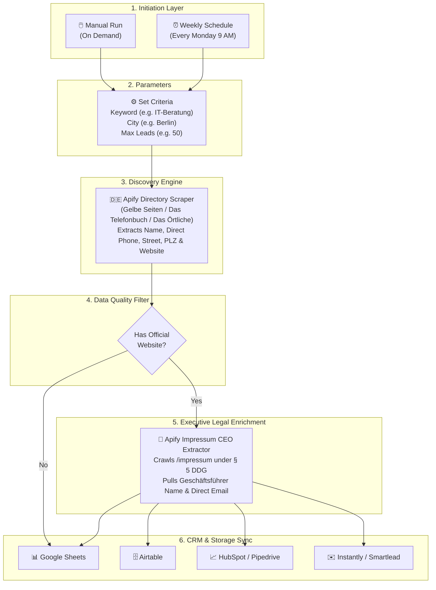

# 🇩🇪 German B2B Lead Machine: Automated n8n Pipeline + Apify Scrapers & Impressum CEO Extractor

[](https://n8n.io)
[](https://apify.com/dach_leads)
[](https://opensource.org/licenses/MIT)
[]()

An end-to-end, production-grade **n8n automation pipeline** that scrapes verified German businesses from major directories and automatically enriches them with **Managing Director (*Geschäftsführer*) names, direct CEO emails, and physical corporate registrations** extracted legally from German company Impressum pages under **§ 5 DDG (German Digital Services Act)**.

---

## 🎯 What Problem Does This Solve?

Cold B2B outreach in Germany (and the wider DACH region) is notoriously difficult:
1. **Generic Inboxes:** Typical scrapers only find `info@domain.de`, leading to 0% reply rates or spam filters.
2. **Obfuscated Phone Numbers:** German directories split phone numbers across hidden DOM spans to block scrapers.
3. **Strict Compliance & Privacy:** Under German law, every commercial website must publish a verified **Impressum** containing the exact legal entity name and Managing Directors (*Geschäftsführer / Inhaber*).

This n8n template automates the complete 2-step pipeline: **Discovery ➔ CEO Enrichment ➔ CRM Sync** in a single click, using 100% native n8n HTTP Request nodes without requiring custom or unverified community nodes.

---

## 🏗️ Architecture & Pipeline Flow



---

## 🚀 Quick Start (3-Minute Setup)

### Step 1: Import the Workflow into n8n
1. Open your n8n workspace (Cloud or Self-Hosted).
2. Click **Add workflow** ➔ Select the **⋮** menu in the top right ➔ **Import from JSON** (or press `Ctrl + V`).
3. Paste the contents of [`workflow.json`](./workflow.json).

### Step 2: Get a Free Apify API Token
1. Sign up for a free account at [Apify.com](https://apify.com) (includes **$5 free monthly credit**).
2. Go to **Settings ➔ Integrations ➔ API Tokens** and copy your token.
3. Open the **`Set Search Criteria`** node in n8n and replace `YOUR_APIFY_API_TOKEN` with your token.

### Step 3: Run the Workflow!
* Enter your target trade or industry (e.g., `IT-Beratung`, `Handwerker`, `Zahnarzt`, `Steuerberater`, `Hotel`).
* Enter your target German city (e.g., `Berlin`, `München`, `Hamburg`, `Frankfurt`, `Köln`).
* Click **Test Step** or **Execute Workflow**.

Your enriched leads will stream directly into the canvas!

---

## 🔌 Powered by Official `dach_leads` Apify Scrapers

This workflow is pre-integrated with the top-ranked German B2B scrapers on the Apify Store:

| Actor | Store Link | Ranking | Purpose |
| :--- | :--- | :--- | :--- |
| **Actor #1** 🏆 | [**Germany Impressum CEO Extractor**](https://apify.com/dach_leads/germany-b2b-lead-impressum-scraper) | **Rank #1 Worldwide** (`germany b2b`) | Enriches websites with Managing Director (*Geschäftsführer*) names, corporate emails, and commercial register IDs. |
| **Actor #2** ⚡ | [**Germany Gelbe Seiten Scraper**](https://apify.com/dach_leads/germany-gelbe-seiten-scraper-fast-b2b-lead-extractor) | **Rank #2 Worldwide** (`gelbe seiten`) | Scrapes 4M+ German businesses from Germany's official Yellow Pages. |
| **Actor #3** 📍 | [**Germany Das Örtliche Scraper**](https://apify.com/dach_leads/germany-dasoertliche-scraper) | Published on Store | High-speed extractor for regional trades, medical practices, and local service providers. |
| **Actor #4** 📞 | [**Germany Das Telefonbuch Scraper**](https://apify.com/dach_leads/germany-dastelefonbuch-scraper) | **Rank #7 Worldwide** (`dastelefonbuch`) | Germany's largest national telephone registry with over 30M+ verified telecommunications records. |

> 💡 **Tip:** To switch the upstream discovery engine from Gelbe Seiten to Das Telefonbuch or Das Örtliche, simply update the Actor URL inside the **Step 1: Scrape Directory Leads** HTTP Request node.

---

## 📊 Sample Output Data Schema

Each lead output by this workflow includes both directory contact details and legally verified executive information:

```json
{
  "company_name": "Andreas Lammel und Thomas Patschinski Lammel & Partner GbR",
  "category": "IT-Beratung",
  "street_address": "Göllweg 15",
  "postal_code": "12107",
  "city": "Berlin",
  "full_address": "Göllweg 15, 12107 Berlin",
  "phone": "+49 30 6692 0010",
  "website": "http://www.lammel-gbr.de",
  "managing_director": "Thomas Patschinski",
  "email": "kontakt@lammel-gbr.de",
  "register_court": "Amtsgericht Berlin-Charlottenburg",
  "vat_id": "DE284719283",
  "source": "Das Telefonbuch & Impressum"
}
```

---

## ⚖️ Legal & Compliance Note (German DDG / GDPR)

Under German federal law (**§ 5 Digitale-Dienste-Gesetz - DDG**, formerly § 5 TMG), every commercial website operated in Germany is legally mandated to maintain a publicly accessible *Impressum* disclosing the registered company entity, Managing Directors (*Vertretungsberechtigte Personen / Geschäftsführer*), and direct contact information. Extracting publicly mandated Impressum data for B2B identification is fully standard across DACH sales intelligence workflows.

---

## 📄 License

This project is open-source under the [MIT License](./LICENSE). Free for commercial and personal use.
